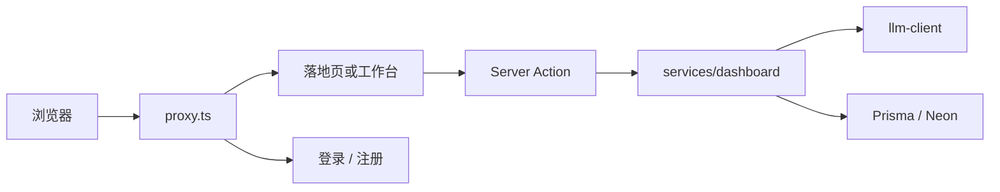

# 项目笔记

## 1. Next.js

Next.js 是基于 React 的全栈框架：页面、服务端逻辑和路由放在同一个项目里，不必再单独部署一套后端。浏览器拿到的是服务端渲染后的 HTML；读数据、校验输入、写数据库发生在服务器上。

常用能力：

- **App Router：** `app/` 目录即路由。文件夹对应 URL，`page.tsx` 是页面。带括号的目录（如 `(auth)`、`(dashboard)`）只分组，不出现在路径里。
- **Server Component（默认）：** 在服务器上执行，可以直接读数据和密钥，这部分逻辑不会进浏览器。
- **Client Component：** 文件顶部加 `'use client'`。负责输入、按钮、本地状态等需要在浏览器跑的交互。
- **Server Action：** 标 `'use server'` 的函数，由表单或客户端直接调用，适合写入操作，调用方不用手写 HTTP。
- **Route Handler：** `route.ts` 暴露 GET/POST 等 HTTP 接口，适合交给认证库或第三方。
- **Proxy：** Next.js 16 用 `proxy.ts` 在请求进入页面前拦截（以前叫 `middleware.ts`），适合做登录跳转，不适合写完整业务。

本项目：

- 请求先经 `src/proxy.ts`（Clerk 中间件）再进 App Router。
- 落地页和工作台是页面；生成/删历史走 Server Actions（`src/app/actions/dashboard.ts`），不暴露 LLM 密钥。
- 工作台需要表单状态，所以 dashboard 及相关面板是 Client Component，经 hooks 调 Action。密钥只出现在带 `server-only` 的模块里。

## 2. Clerk：托管认证

Clerk 是外部托管认证服务，不是装在自己数据库里的库。

|       | Clerk（本仓库）                                    | Better Auth（guestbook 仓库） |
| ----- | --------------------------------------------- | ------------------------- |
| 用户数据  | 在 Clerk                                       | 在自己的 Postgres             |
| 本地要做的 | 配密钥、嵌 SignIn/SignUp、用 `auth()` 取 `userId`     | 装库、建用户/会话表、自己管密码哈希        |
| 登录 UI | Clerk 组件（`/login`、`/register` 的 catch-all 路由） | 自己写表单                     |

- 工作台只把 Clerk `userId` 当成历史表的外键字符串，不在 Neon 里镜像用户资料。早期 schema 里的 `user_profiles` 和 `generated_contents.title` 已删除。
- OAuth 回跳必须配 `FORCE_REDIRECT` / `FALLBACK_REDIRECT` 到 `/dashboard`，并在 `ClerkProvider` 上写同一组 URL。漏掉时会出现「第三方登录成功却停在落地页」。
-`createRouteMatcher` 在较新的 Clerk 文档里已不推荐，但当前版本仍可用。保活时若升级 Clerk，优先核对其替代 API，而不是继续加业务。

## 4. Prisma

Prisma 是开源 ORM：用一份 schema 描述数据模型，生成类型安全的客户端，再用迁移把表结构同步到数据库。它是装在项目里的库，不是托管数据库。

常规流程：在 `schema.prisma` 里定义 model → `prisma generate` 生成 Client → `prisma migrate` 写出 SQL 并应用到数据库 → 业务代码 `import { PrismaClient }` 做增删改查。

和「直接改库」的两种命令：

- **`migrate dev`：** 本地开发，根据 schema 生成迁移文件（可交互）。
- **`migrate deploy`：** 把仓库里已有的迁移应用到 `DATABASE_URL` 指向的库，适合线上；不需要本机安装 PostgreSQL。
- **`db push`：** 把 schema 直接推到库、不留迁移文件。本仓库用迁移历史，线上不要用 push 代替 deploy。

迁移需要数据库的 **Direct** 连接（Neon 主机名不含 `-pooler`）；应用运行可以用 pooled 连接。

本项目数据库在 Neon（PostgreSQL）。唯一业务表是 `generated_contents`：按 Clerk `userId` 隔离读写，删除用 `deleteMany({ id, userId })`。线上已用 `migrate deploy` 去掉未使用的 `user_profiles` 和 `title` 列。Client 封装在 `src/lib/prisma.ts`（`server-only`）。

## 5. Tailwind CSS 与 Radix UI

Tailwind 是 utility-first 的 CSS：在 class 里写 `flex`、`text-sm`、`border-border` 这类原子类，由构建工具扫源码生成样式表，不必为每个组件单独写 CSS 文件。v4 用 `@import 'tailwindcss'` 和 `@theme` / CSS 变量组织设计 token。

Radix UI 提供无样式、可访问的 React 原语（下拉、选择、滚动区域等）：负责键盘操作、焦点和弹层，外观由你自己的 class 决定。常见搭配是「Radix 行为 + Tailwind 外观」，也就是 shadcn/ui 那一类封装。

本项目：`src/app/globals.css` 引入 Tailwind 4 和主题变量（含 dark variant）；`next-themes` 给 `html` 加 `class` 切深浅色。实际用到的 Radix 只有 dropdown-menu、select、scroll-area、label、slot，封装在 `src/components/ui/`。其余 v0 脚手架组件已删。

## 6. Neon

Neon 是托管的 Serverless PostgreSQL：库在云端，按用量扩缩，应用通过连接串访问。和自建 Postgres 的差别主要在运维（备份、分支、连接池由厂商做），SQL 和表结构仍是标准 PostgreSQL。

Neon 通常给两种连接串：

- **Pooled（主机名含 `-pooler`）：** 适合短连接的 Serverless 运行时（Vercel），减少连库开销。
- **Direct（不含 `-pooler`）：** 适合迁移、Prisma Migrate 需要的会话级锁。

本项目历史数据存在 Neon。应用 `DATABASE_URL` 可用 pooled；`pnpm db:migrate:deploy` 必须用 Direct。Prisma 是访问层，Neon 是库本身。

## 7. Vercel

Vercel 是面向前端/全栈的托管平台：连上 Git 仓库后，push 到指定分支会自动构建并发布。Next.js 由它原厂支持，Server Component、Server Actions、环境变量都在其运行时里执行。Preview 部署对应 PR/非生产分支，Production 对应生产域名。

环境变量配在 Vercel 项目设置里，**不会**随 git 里的 `.env` 上传。改了 `NEXT_PUBLIC_*` 后要重新部署，构建时才会打进客户端包。

本项目生产站是 [copy-ai-seven.vercel.app](https://copy-ai-seven.vercel.app)。根 layout 还挂了 `@vercel/analytics`。构建命令是 `next build`，**不**在构建里跑数据库迁移，避免 Preview 打到同一套 Neon。迁移在本机对线上库执行 `migrate deploy`。

## 8. GitHub Actions

GitHub Actions 是仓库内的 CI/CD：用 YAML 描述「在什么事件下、跑哪些命令」。常见用途是每次 push 或 Pull Request 时自动安装依赖、跑测试和构建，把问题挡在合并前。

和工作流相关的概念：触发条件（`on`）、作业（`jobs`）、步骤（`steps`）、密钥（Secrets）。CI 里的环境变量应是占位或只读，不要用生产库的可写连接去做质量检查。

本项目：`.github/workflows/ci.yml` 在 `main` 的 push/PR 上跑 pnpm 安装、`prisma generate`、typecheck、lint、测试和生产构建。Clerk 和数据库用假值，**不连接 Neon、不执行 migrate**。质量门禁和改线上 schema 是两件事。

